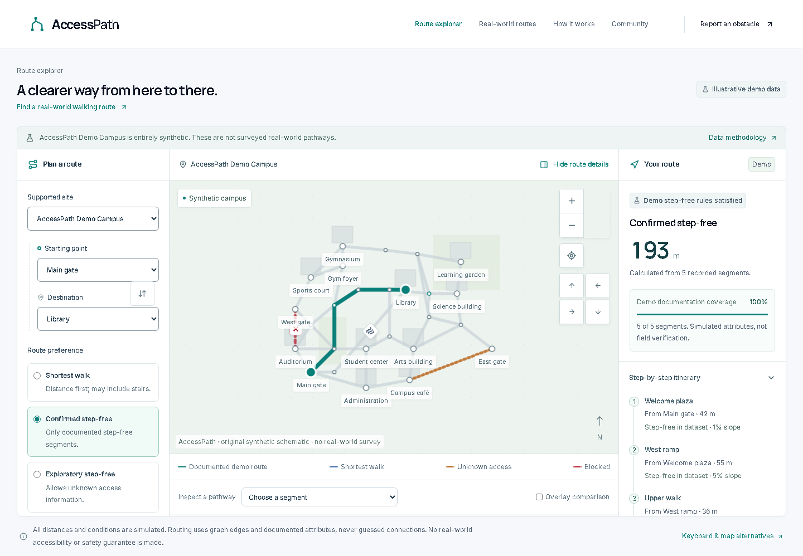

# AccessPath

**Every route should be accessible.**

Cloud handoff: a protected Vercel preview is READY; GitHub publication and full remote database configuration remain pending. See [current launch status](docs/LAUNCH_STATUS.md).

AccessPath compares pedestrian routes using documented pathway attributes, including stairs, slopes, surfaces, curbs, and closures. It explains route choices and missing information instead of treating an unknown path as confirmed step-free.

This independent prototype ships with **AccessPath Demo Campus**. All campus geography and pathway attributes are synthetic: **Illustrative demo data — not a verified real-world accessibility survey.** Palos Verdes Peninsula is only a potential future pilot context. No partnership, real survey, user study, impact result, or accessibility certification is claimed.

## What the prototype contains

- A schematic interactive route explorer with standard form controls and a text itinerary.
- Deterministic graph-based shortest, confirmed step-free, and exploratory route modes.
- Route comparisons, segment attributes, explicit unknowns, and useful unreachable states.
- Labeled closure/uncertainty scenarios using synthetic graph data.
- Server-validated obstacle reports persisted as pending; protected moderator review when configured.
- Coverage and evidence views derived from application data, with demonstration labels.
- A separate [real-world walking planner](http://localhost:3050/routes) with manual place search, coordinate or map selection, real walking geometry, written directions, and a Google Maps handoff. Its routes are explicitly **accessibility unverified**.

Actual executed verification and remaining limitations are recorded in [the test report](docs/TEST_REPORT.md). A feature list alone is not evidence of successful deployment or community validation.

## Run locally in Windows PowerShell

Use Node.js **24 LTS** and npm. The package declares Node 22.12 or later; Node 24 is the intended local test runtime. Start in this `accesspath` directory.

```powershell
npm.cmd ci
Copy-Item .env.example .env.local
npm.cmd run db:migrate
npm.cmd run db:seed
npm.cmd run dev
```

Open [http://localhost:3050](http://localhost:3050). On mobile and tablet, use the **Plan your route** bottom bar to open preferences; Escape closes the nonmodal sheet. The mobile menu provides the full navigation. Local SQLite works without cloud credentials. The seed is synthetic and repeatable; do not use it to overwrite a future real survey. Read [deployment and environment setup](docs/DEPLOYMENT.md) before enabling moderation or changing storage. Keep actual secrets out of source control and recordings.

For actual public-map routes, open **Real-world routes** at `/routes`. Submit a place search, choose a result for each endpoint, or enter coordinates/select points on the map, then calculate a walking route. Search is manual, without autocomplete or automatic retries. This mode uses Photon, FOSSGIS's OSRM foot-profile server, and OpenStreetMap tiles. Public services have limited capacity and no application availability guarantee. A shared SQL gate spaces upstream requests by at least 1.1 seconds per provider; local SQLite supplies that gate locally. Hosted live API requests require a shared persistent database. See [live routing, privacy, and provider limits](docs/LIVE_ROUTING.md).

On shells where npm is directly executable, use `npm` in place of `npm.cmd`.

## Demo walkthrough

1. Open **Explore routes**, keep **AccessPath Demo Campus**, and choose the baseline scenario.
2. Compare **Shortest Walk** with **Confirmed Step-Free** for the provided stair-shortcut example. Inspect the ordered itinerary and segment details.
3. Try the explicitly labeled closure scenario and observe recalculation from the modified graph.
4. Try uncertain/disconnected scenarios. Strict routing must show no qualifying route where data does not support one; choose exploratory deliberately to inspect unknown sections.
5. Submit a clearly synthetic report. Confirm it is pending and retains its reference after reload. A report does not automatically modify route verification.

## Screenshots

Captured from the running application with synthetic data. Browser verification and its limits are recorded in the test report.



[Mobile explorer](output/playwright/explorer-mobile.png) · [Tablet explorer](output/playwright/explorer-tablet.png) · [Obstacle reporting](output/playwright/report-desktop.png)

The type-check script runs `next typegen` first, so Next’s generated route declarations do not need to be included in the source archive.

[Actual public-place walking-route screenshot](output/playwright/live-public-route-desktop.png) · [Provider integration and verification](docs/LIVE_ROUTING.md)

Latest extension verification: **107 local tests and33 browser tests passed**; see the test report for exact scope and limitations.

## Checks

```powershell
npm.cmd run lint
npm.cmd run typecheck
npm.cmd test
npm.cmd run build
npx.cmd playwright install chromium firefox
$env:ACCESSPATH_E2E_START_SERVER = '1'
npm.cmd run test:e2e
Remove-Item Env:ACCESSPATH_E2E_START_SERVER
```

The opt-in browser test server uses the production build on port **3060**, a separate ignored SQLite test database, and throwaway moderator credentials. It does not use your configured administrator key. The configuration automatically detects this workspace's bundled browsers when available; on another machine, the Playwright install command above supplies them. Custom browser paths can be set with `ACCESSPATH_CHROMIUM_PATH` and `ACCESSPATH_FIREFOX_PATH`.

Without the opt-in flag, tests expect an already running server at `ACCESSPATH_E2E_BASE_URL` (default `http://127.0.0.1:3060`). Only run mutation tests against disposable test storage. See [the test report](docs/TEST_REPORT.md) for actual results, viewport screenshots, and any checks not performed. To serve a completed build normally on port 3050, run `npm.cmd start`.

## Stack and boundaries

Next.js App Router, React, strict TypeScript, Tailwind CSS, Leaflet/React Leaflet, Lucide, Motion, Zod, Drizzle ORM, libSQL/SQLite, Vitest, Testing Library, Playwright, and axe-core. Exact installed versions are pinned by `package-lock.json`.

The pure route engine validates a site graph, filters edges, runs Dijkstra with a binary min-heap, and returns ordered nodes/edges plus calculated explanations. The map and text result share that output. Server code owns database access and moderator authorization. See [architecture](docs/ARCHITECTURE.md) and [routing methodology](docs/ROUTING_METHODOLOGY.md).

No map tile service, geocoding key, live AI service, or paid account is needed for the **schematic demo** at `/explore`. The separate `/routes` page does make disclosed external requests for street tiles and user-submitted searches/routes. Its Google Maps button opens Google walking directions for the selected endpoints; it does not embed Google's map or use a Google routing API, and needs no Google API key. Google calculates its own route.

Serverless deployment cannot use local writable SQLite as durable report storage or as a shared live-provider request gate: configure a supported remote database, or reporting and uncached live API requests clearly fail as unavailable. The schematic demo remains readable. No public deployment or persistent cloud database is established by this README.

## Accessibility, privacy, and limitations

Text itineraries and labeled form controls provide essential map alternatives. Status is communicated in words as well as color, with keyboard focus and reduced-motion support. Target and actual checks are separate in [accessibility](docs/ACCESSIBILITY.md).

No device geolocation, legal name, school ID, camera, or photo upload is requested. The real-world planner does process the place queries and coordinates you deliberately submit; providers receive the information described in [privacy](docs/PRIVACY.md). Reports are untrusted until reviewed. See [data verification](docs/DATA_VERIFICATION.md). Public-map walking directions do not verify stairs, slopes, curb access, width, surfaces, closures, or individual suitability, and are never promoted to the demo's confirmed step-free mode. Routes are not emergency instructions, professional mobility assessments, or legal compliance advice.

A public-data functional check on October 18, 2026 returned a 315.2 m walking route from Torrance City Hall to Katy Geissert Civic Center Library. The actual provider response is saved in [output/live-public-route.json](output/live-public-route.json); the planner and Google handoff were opened and inspected. This was a software integration check, **not a field survey or mobility validation**. See [the live-routing record](docs/LIVE_ROUTING.md#public-data-functional-check) and the test report for the distinct scope of browser and automated checks.

## Submission and next steps

- [Official-rule checks and unresolved deadline/eligibility differences](docs/HACKATHON_RULES.md)
- [Community validation workbook — no fabricated interviews](docs/COMMUNITY_VALIDATION.md)
- [Ready-to-edit Devpost draft](docs/DEVPOST_SUBMISSION.md)
- [3–4 minute video recording plan](docs/DEMO_SCRIPT.md)
- [Development progress](docs/PROGRESS.md)

The student still needs genuine local evidence, meaningful review/testing contributions, a public repository, and a recorded working video before claiming submission readiness. Future work should begin with one permitted, maintained campus pilot and assistive-technology testing, then expand coverage based on reviewed evidence.

OpenAI Codex assisted development and documentation, with UI/UX Designer and UI UX Pro Max guidance. The 21st local design-context workflow was used; catalog search/usage required sign-in, so no catalog component or hosted generation is claimed. The final submission must disclose the student's own contributions; use the editable disclosure in the Devpost draft. No submission or publication is performed by these documents.
